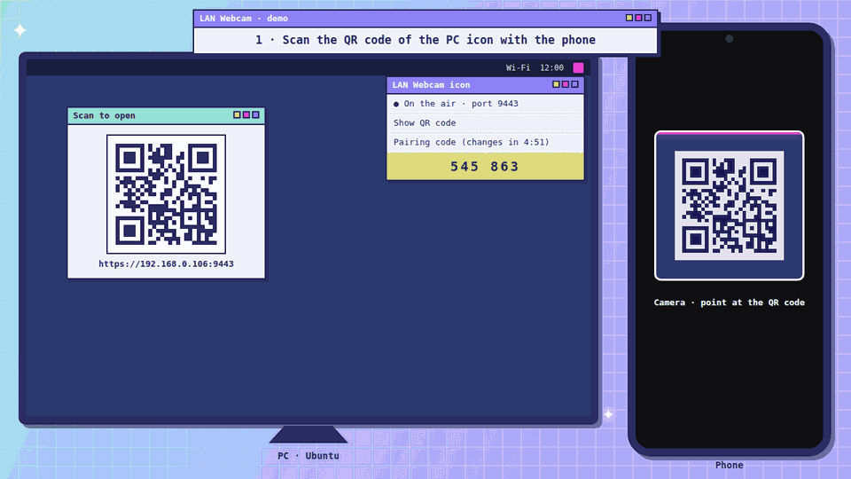
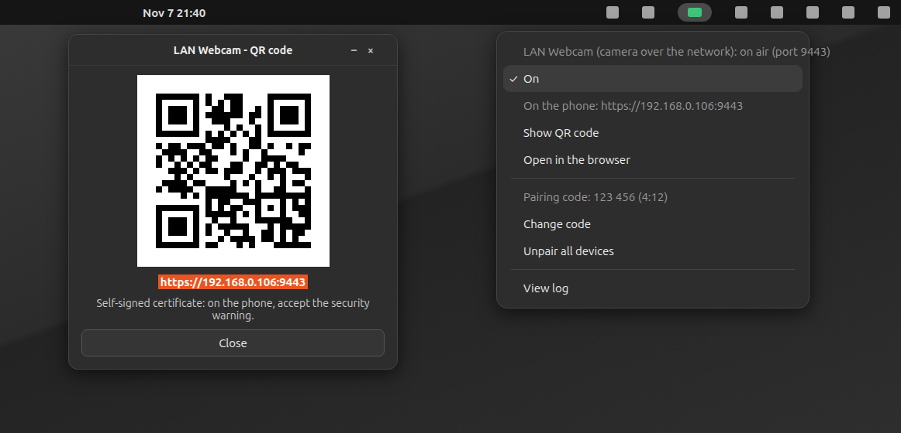

<div align="center">

# LAN Webcam

**Any camera on your local network becomes a webcam on the PC (`/dev/video10`, "LAN Webcam").**


[](https://github.com/gabrielogregorio/devkit-lan-webcam/actions/workflows/tests.yml)
[](https://github.com/gabrielogregorio/devkit-lan-webcam/actions/workflows/check-quality.yml)
[](https://github.com/gabrielogregorio/devkit-lan-webcam/actions/workflows/codeql-analysis.yml)
[](https://github.com/gabrielogregorio/devkit-lan-webcam/releases)

<br>



<sub>Recorded with the real page, TLS and WebSocket server, a simulated camera and a simulated PC app: frames went to the demo, not to <code>/dev/video10</code>.</sub>

</div>

## About

Turns the camera of any device on the same network (phone, tablet, another laptop) into a
**virtual webcam on the PC** (Ubuntu). The device opens a small web app served by the PC, captures its
camera and sends the frames; on the PC they become the `/dev/video10` device that apps (Chrome,
Zoom, OBS, Meet…) list as the **"LAN Webcam"** camera. No app to install on the device: a browser
with camera access is enough.

> **Same network required.** The camera device and the PC must be on the same local network (same
> Wi-Fi or the same router, cable counts). The page is reached by the PC's local IP
> (`https://<pc-ip>:9443`); nothing goes through the internet, so it does not work from another
> network or over mobile data. A guest Wi-Fi with client isolation also blocks it.

- **Three linked pages** on `https://<pc-ip>:9443`, with **Stream** and **Watch** at the top of
  every page:

  | Page | Address | What |
  |---|---|---|
  | Home | `/` | the network: the router, this PC and every device, one line each |
  | Stream | `/stream` | streams this device's camera to the PC |
  | Watch | `/watch` | shows live the camera another device is streaming |

  Moving between pages does not stop the streaming of this device.
- **Live controls on the Stream page:** zoom (slider or pinch), drag to move, mirror, rotate 90°, fit
  or crop, reset, back/front camera buttons and a lens dropdown.
- **Paired and encrypted:** every device pairs once with a 6-digit code the PC shows (it changes
  every 5 minutes); after that, everything between the browser and the PC is encrypted, even over
  plain HTTP. The code never travels over the network. See [Security](#security).
- **The camera decides who watches:** each Watch tab asks with its own random key; the Stream page
  lists every request (code, IP, device) and approves, denies or revokes each one. Only approved
  requests get frames.
- **Stream quality on the camera device:** resolution (360p, 540p, 720p), frames per second (10 to 30)
  and JPEG quality, with the measured size per frame.
- **Network panel** (the home page, and below the Stream page; not on Watch): one line per machine: the router, this PC (with any page open on
  it), the camera and every other device with its role, and which one is you. Never the pairing code:
  anyone looking at a screen, or at a screen shared in a call, could pair with it.
- **The preview is the canvas that is sent:** what you see on the device is exactly what the PC gets.
- **Language:** English, Brazilian Portuguese, Spanish, French, Chinese (simplified), Hindi and Japanese.
  Pick one in the menu at the top of every page: it switches at once, without reloading (a camera that is
  streaming keeps going), and this browser remembers it. Without a choice the page follows the browser
  language, else English. Force one with `?lang=` (`en`, `pt-BR`, `es`, `fr`, `zh`, `hi`, `ja`).

Built and tested on Ubuntu 24.04.

## Set up on a new PC

1. **Install** (asks for sudo: `v4l2loopback-dkms`, `ffmpeg`, `python3-venv`…, the venv, the web app
   build and the HTTPS certificate). The web app needs **Node 24** through
   [nvm](https://github.com/nvm-sh/nvm); `setup.sh` runs `nvm install 24` when nvm is there, and pnpm
   comes from Corepack (the version is pinned in `package.json`):
   ```bash
   git clone <repo-url> devkit-lan-webcam
   cd devkit-lan-webcam
   ./setup.sh
   ```
2. **Make the virtual webcam permanent** (loads at boot with `exclusive_caps=1`, which Chrome needs):
   ```bash
   sudo bash reload-cam.sh
   ```
   With Secure Boot on, `v4l2loopback-dkms` asks to enroll a key (MOK) during the install; accept it
   and confirm on the next boot, or the module does not load.
3. **Optional, recommended:** let `run.sh` reload the module without a password on every start
   (avoids the `VIDIOC_G_FMT` error on the 2nd opening). The 3 commands are at the top of
   `reload-mod.sh`, and `run.sh` prints them when it does not find the setup.
4. **Check and use:**
   ```bash
   ./run.sh status     # server + /dev/video10 + exclusive_caps
   ./run.sh            # starts and prints the address for the device
   ```
   Use Google Chrome from the `.deb` on the PC (the snap does not see `/dev/video10`).
5. **Top bar icon (optional):** `./tray_icon.py --install` puts an icon on the top bar at every
   login, gray while off. Its menu turns the server on and off; turning it on opens a QR code with
   the address, so the device does not need it typed:

   

   The menu follows the system language (the screenshot is in Brazilian Portuguese: Ligado = On,
   Mostrar QR code = Show QR code). The address is the PC's local IP, so the QR code only works on
   the same network. Without `python3-segno` the QR window shows only the address.
   `./tray_icon.py --remove` takes the icon out of the login.
   The icon runs on the system python3 and needs `sudo apt install python3-gi gir1.2-gtk-3.0
   gir1.2-ayatanaappindicator3-0.1` (already on a standard Ubuntu desktop) plus `python3-segno` for
   the QR code.

   Menu: the status line ("LAN Webcam (camera over the network): on air (port 9443)"), **On**
   (starts or stops the server), the address for the device, **Show QR code**, **Open in the
   browser**, the **pairing code** with the time it still lasts, **Change code** (the current code
   stops working at once), **Unpair all devices** (every device needs a code again), **View log**
   (the server output). A middle click on the icon toggles it.

**Outside the repository:**

| Path | What |
|---|---|
| `cert.pem`, `key.pem` | self-signed HTTPS certificate, generated, ignored by git |
| `.env` | `LAN_WEBCAM_ENTROPY_SECRET`, the secret of this install mixed into every random byte (`entropy.py`); written on the first run, mode 600, ignored by git; `.env.example` shows the format; `LAN_WEBCAM_ENV_FILE` moves it |
| `.venv/` | Python venv with `aiohttp` (Ubuntu's Python is externally managed: never a global pip) |
| `node_modules/`, `web/dist/` | pnpm packages and the built web app, both generated, ignored by git |
| `/etc/modprobe.d/v4l2loopback.conf` | module options (`video_nr=10`, `card_label="LAN Webcam"`, `exclusive_caps=1`) |
| `/etc/modules-load.d/v4l2loopback.conf` | loads the module at boot |
| `/usr/local/sbin/webcam-cam-reload`, `/etc/sudoers.d/webcam` | optional passwordless module reload (step 3) |
| `~/.config/autostart/devkit-lan-webcam-tray.desktop` | starts the top bar icon at login, off (`./tray_icon.py --install`; `--remove` takes it out) |
| `~/.local/share/applications/devkit-lan-webcam-tray.desktop` | app menu shortcut for the icon (same command) |
| `~/.cache/devkit-lan-webcam/` | the icon's `server.log` ("View log"), on/off SVGs, the QR code PNG and its lock |
| `~/.config/devkit-lan-webcam/` | `pairing.json` (seed of the rotating code) and `devices.json` (paired devices and their secrets), folder 700, files 600; `LAN_WEBCAM_CONFIG_DIR` moves it |

Moved the folder? Recreate the venv (`mv .venv trash/` and `./run.sh` creates it again).

## Available scripts

```bash
# Run
./run.sh            # builds the web app when needed, starts and prints the address (Ctrl+C stops it)
./run.sh status     # server + virtual webcam
./run.sh stop
./run.sh restart
./run.sh code       # the pairing code devices type once (also in the top bar icon)

# Pairing state (also in the top bar icon)
python3 pairing.py rotate   # change the code now
python3 pairing.py unpair   # forget every paired device

# Top bar icon (on/off, QR code), at every login
./tray_icon.py --install
./tray_icon.py --remove

# Web app (Node 24: nvm use 24)
corepack pnpm install --frozen-lockfile
corepack pnpm run dev           # Vite dev server for working on the pages (no camera server behind it)
corepack pnpm run build         # web/dist, what server.py serves
corepack pnpm run lint          # eslint + tsc
corepack pnpm run unit          # vitest in watch mode
corepack pnpm run check:all     # prettier, lint, unit with 100% coverage, build

# Test (never touches port 9443 nor the real /dev/video10)
./run-tests.sh                      # lint + backend + web app + launcher
RUN_E2E=1 ./run-tests.sh            # + Playwright E2E (once: corepack pnpm exec playwright install chromium-headless-shell)
RUN_DEVICE_TESTS=1 ./run-tests.sh   # + the real /dev/video10

# Dependencies (uv)
uv sync --all-groups
uv lock && uv export --frozen --no-dev --no-emit-project -o requirements.txt
```

## Tests

| Kind | Where | What it covers |
|---|---|---|
| **Lint** | `pyproject.toml` (ruff), ShellCheck | Python style, import order, bug patterns; warnings in every `.sh` |
| **Backend** | `tests/backend/` (pytest), speaking the real protocol through `secure_client.py` | routes and caching, nothing outside `web/dist/assets` reachable, 503 without a build; pairing (`test_pairing.py`): the current and the previous code pair, a wrong code does not, an IP is blocked after 5 wrong codes and pairing locks after 10 until the code changes, changing the code and unpairing work, private file modes; encryption (`test_crypto_channel.py`, `test_robustness.py`): HKDF against RFC 5869, replayed, reordered, tampered and forged messages refused, malformed handshakes closed, a message reflected to its sender or with a rewritten counter refused; break tests (`test_wire_tap.py`, through a recording relay in the middle of the TCP connection, see [docs/security.md](docs/security.md)): a recorded session shows no picture, no app message and no secret, the same picture never repeats on the wire, a flipped bit ends the session before the webcam, a session played back later gets nothing; camera (`test_ws_handler.py`): one ffmpeg per camera, frames decrypted into its stdin, a new camera takes over, broken pipe, ffmpeg missing, the log keeps every ffmpeg line but the two the release marker causes (checked against the real ffmpeg when it is installed); watching (`test_watch.py`): only approved requests get frames, deny and revoke, one request per tab key and per IP, a viewer cannot approve itself, the camera leaving resets approvals, the network panel; randomness (`test_entropy.py`): the same nanosecond and process id still draw new bytes, two fresh clones started at the same instant write different `.env` secrets, with the kernel generator broken the `.env` secret alone separates two installs, the `.env` is created with mode 600 and reused, filled when empty, a broken value never stops the server, no other module draws randomness on its own; `test_crypto_vectors.py`: the browser vectors still match |
| **Break tests bite** | `tests/backend/plugin_without_encryption.py` | the break tests run again with the encryption turned off and must fail, so they cannot pass by accident |
| **Crypto vectors** | `tests/backend/crypto_vectors.py` → `web/src/lib/crypto/vectors.json` | fixed-input outputs of the server's SPAKE2, sealed credential and session handshake; the browser tests must produce the same bytes |
| **Web lint** | `eslint.config.mjs`, `tsconfig.json`, `.prettierrc` | ESLint (typescript-eslint with types, react, react-hooks, jsx-a11y, sonarjs), strict TypeScript, Prettier |
| **Web unit** | `web/src/**/*.test.{ts,tsx}` (Vitest + Testing Library) | 100% coverage gate: the browser crypto against the server vectors, the encrypted connection and the session store against a fake server doing a real handshake, the pairing client, storage, framing math, gestures, routes, server messages, device labels, quality settings, every page text, the i18n catalogs (every `t('…')` has its line in each of the 6 translations with the same `{placeholders}`, none unused), the language menu, and the pages: pairing form, network panel, request list, quality controls, navigation, the Watch page states |
| **Launcher** | `tests/launcher/test_launcher.sh` | `run.sh` in a sandbox with stubs: status, missing device, `exclusive_caps` warning, single instance, stop, usage, builds the web app when it is missing, says how to install Node when it cannot |
| **E2E** | `tests/e2e/` (Playwright) | the real `server.py` serving the real build, with its own config folder and ffmpeg swapped for `cat`; Chromium with a fake camera, every device in its own browser context pairing with the code from `pairing.py`: a wrong code does not pair, preview and camera switching, encrypted frames decrypted on the server at the chosen resolution, navigation, and over **plain HTTP on the LAN address** (no `crypto.subtle`) two devices ask to watch and only the one the camera approves gets the picture, until it is revoked; a whole watch session on plain HTTP recorded by a relay (`wire-tap.mjs`) carries encrypted frames and no JPEG, app message or device secret |
| **Device** | `tests/backend/test_device_integration.py` | opt-in: `/dev/video10` exists and is readable and writable |

`./run-tests.sh` prints a scoreboard and skips what is not installed (ShellCheck:
`sudo apt install shellcheck`), saying so. The E2E runs in English.

## CI/CD

GitHub Actions, in `.github/`:

| Workflow | When | What |
|---|---|---|
| `tests.yml` | push/PR to `main`, manual | unit layers (lint, backend, web app, launcher), then the E2E with Playwright; the server log is uploaded when the E2E fails |
| `check-quality.yml` | push/PR to `main` | ruff, ShellCheck, Prettier + ESLint + tsc, E2E script syntax, `.sh` files executable in git, actions pinned to a hash, workflow YAML; on PRs only, dependency audit with pip-audit and `pnpm audit` (zero in production, zero high in the tools) |
| `codeql-analysis.yml` | push/PR, weekly | CodeQL for Python, JavaScript and the workflows |
| `auto-complete-fields.yml` | PR opened/updated | assigns the author, labels by commit words and touched files, lists the commits in the PR body (`[...autoGenerate]`), titles it `Release vX.Y.Z - …`, fails on a `release/x.x.x` branch if that version was already released |
| `create-tag-and-release.yml` | PR merged into `main` | creates the tag `vX.Y.Z` from `VERSION` and a GitHub release with the PR text, generated notes, the source tarball and `SHA256SUMS` (a `-rc.1` style version becomes a pre-release) |

`setup-environment` (composite action) sets up Node from `.nvmrc`, installs the pnpm packages from
`pnpm-lock.yaml` (`--frozen-lockfile`), creates the venv from `requirements-dev.txt` and, for the E2E,
installs Playwright's Chromium and a throwaway certificate.

**Pinned versions.** Every third-party action is pinned to the full commit hash of its release tag,
with the version as a comment, so a moved or hijacked tag cannot change what runs:

| Action | Version | Commit |
|---|---|---|
| `actions/checkout` | v6.1.0 | `d23441a48e516b6c34aea4fa41551a30e30af803` |
| `actions/setup-node` | v7.1.0 | `949feb2413d6458794dcd2491c4babbbce0c15c1` |
| `actions/upload-artifact` | v6.0.0 | `b7c566a772e6b6bfb58ed0dc250532a479d7789f` |
| `actions/github-script` | v8.0.0 | `ed597411d8f924073f98dfc5c65a23a2325f34cd` |
| `github/codeql-action` (init, analyze) | v4.39.1 | `9b3254085494b55a0f7c4c2b3d2d52cc712ce370` |

The rest is pinned too: runners on `ubuntu-24.04` (not `ubuntu-latest`), Node 24 from `.nvmrc`, pnpm
with its hash in `packageManager`, npm packages from `pnpm-lock.yaml` (Playwright included) and Python
packages from `uv.lock` (through `requirements-dev.txt`, ruff included), installed with
`--require-hashes` and without upgrading pip first (that would fetch the newest pip, unhashed).
Every checkout uses `persist-credentials: false`, so no token stays in `.git/config` for later steps;
the tag checks ask the GitHub API instead of `git ls-remote`.
`check-quality.yml` fails if a `uses:` is not a 40-character hash (local `./` actions excepted).
Dependabot opens monthly PRs for the actions (hash and comment together), the npm packages and the
Python packages (`uv.lock`), all waiting 3 days after a release. To pin one by hand:

```bash
git ls-remote --tags https://github.com/actions/setup-node.git 'v7.1.0^{}' 'v7.1.0'   # the ^{} line, when present, is the commit
```

### Releasing

1. In a PR from a `release/x.x.x` branch, bump `VERSION` (semver: `1.1.0`, or `1.1.0-rc.1` for a pre-release).
2. Merge into `main`. The tag and the release are created on their own.

What the release is built from:

| Part | Source |
|---|---|
| Tag | `v` + `VERSION` at the merge commit, pointing at that commit |
| Title | `LAN Webcam vX.Y.Z` |
| Notes | the PR title (without the `Release vX.Y.Z - ` prefix), then the PR body with the commit list that `auto-complete-fields.yml` filled in (the `[...autoGenerate]` marker is removed), then GitHub's generated notes (merged PRs, contributors, "Full Changelog" link to the previous tag) |
| Files | `devkit-lan-webcam-X.Y.Z.tar.gz` (`git archive` of the merge commit: only tracked files) and `SHA256SUMS` |
| Type | a version with `-` (e.g. `1.1.0-rc.1`) is a pre-release; any other becomes "latest" |

If the tag already exists (the PR did not bump `VERSION`), nothing is released and the run leaves a
warning. On a `release/x.x.x` branch, the PR check `VERSION is new` catches that before the merge;
PRs from any other branch skip it, so they can merge without a new version.

Issues use forms (`bug_report.yml`, `feature_request.yml`); PRs start from `pull_request_template.md`.

## Usage (order matters)

1. Start the server on the PC (`./run.sh`).
2. **On the camera device** (on the **same network** as the PC): open `https://<pc-ip>:9443` (or scan
   the QR code from the top bar icon) and accept the certificate warning. The first time, the page
   asks for the **pairing code**: type the 6 digits from the top bar icon (or `./run.sh code`). Then go
   to **Stream** (`/stream`). Pick the camera (**Back** / **Front** or the dropdown): the preview shows up even
   before streaming. Adjust zoom and position, then **Start streaming** (status "Streaming"). Hold a phone
   **sideways (landscape)** to match the 16:9 webcam. Keep the page open and the screen on.
3. **On the PC:** apps only look for cameras when they open, so close and reopen the target app
   **with the feed already on**, and pick **"LAN Webcam"**.
4. **Optional, watch on other devices:** another device opens `https://<pc-ip>:9443/watch` or, over
   plain HTTP with no certificate warning, `http://<pc-ip>:9080/watch`; it pairs with the code from
   the top bar icon (or `./run.sh code`) and taps **Ask to watch**. Its page
   shows a code like `ab12-cd34`. On the camera device, **Who may watch** lists the request with
   the same code, the IP and the device: **Approve** it. Compare the codes before approving: another
   device on the network may ask too, and only the one you approve gets the picture. **Deny** and
   **Revoke** stop it at once. Approvals last while the camera streams; a tab that reloads keeps its
   key and its approval.
5. **Optional, quality:** on the Stream page, **Stream quality** sets resolution, frames per second and
   image quality; the measured size per frame shows up while streaming.

## Architecture

```
[Camera device] getUserMedia → canvas → JPEG (10-30 fps) → encrypted session
   │  /ws/session (wss on 9443)
   ▼
[PC] server.py (aiohttp: HTTPS 9443, plain HTTP 9080)  decrypts each frame
   │  writes the JPEGs to ffmpeg's stdin
   ▼
[ffmpeg]  -f mjpeg -i pipe:0 → scale/yuv420p → -f v4l2 /dev/video10
   ▼
[v4l2loopback]  /dev/video10  ("LAN Webcam")  → Chrome/Zoom/OBS/…

[PC] server.py ── approved requests only, encrypted per session ──▶ [other devices] Watch page ()
```

- **HTTPS is required for the camera:** browsers only allow `getUserMedia` outside `localhost` in a
  secure context. Self-signed certificate in `cert.pem`/`key.pem` (accept the warning on the device).
  Watching works over plain HTTP too (`HTTP_PORT`, 9080 by default, 0 turns it off).
- **One session per page** (`/ws/session`): streaming, asking to watch, deciding and the network panel
  all go through it. `ffmpeg` starts when that page sends `camera-start` and stops on `camera-stop`
  or when it disconnects; a newer camera takes over and the older one is told.
- Each frame is a whole JPEG; `ffmpeg -f mjpeg` reads the stream from `pipe:0`. An empty JPEG after
  each frame makes ffmpeg release it at once instead of one frame later (83 ms → 43 ms at 25 fps). The
  decoder rejects that empty JPEG with two known lines per frame; `server.py` drops exactly those and
  writes every other ffmpeg line to its log as `[ffmpeg] …`.
- **The web app** is React + TypeScript, built by Vite into `web/dist`. `server.py` serves its
  `index.html` on `/`, `/stream` and `/watch` (the app picks the page from the address and moves
  between pages without reloading) with `Cache-Control: no-store`, so a new build always arrives. The
  hashed files in `/assets/` are cached for a year, since a new build gives them new names. Nothing
  outside `web/dist` is reachable; without a build the pages answer 503 with what to run.
- The preview on the device **is the canvas itself**; the camera opens in a hidden `<video>` that is
  the drawing source.
- A stalled network does not pile up frames: the page keeps at most one frame in flight and skips
  the next while the previous is still being encoded or sent.
- **Watching on other devices** (`access.py`): a Watch tab sends `{"type": "request", "key"}` with a
  random 128-bit key kept in that tab (`sessionStorage`). The request is identified by
  SHA-256(ip + key), so the same key from another machine is another request; its first 8 hex digits
  are the code both screens show. The camera sends `{"type": "decide", "id", "decision"}`; only the
  current camera can decide. The server relays the same JPEGs it decrypted, re-encrypted per approved
  session, without re-encoding the image; a viewer still receiving the previous frame skips the next
  one, so a slow viewer never slows the camera or the PC webcam. When the camera stops, every
  approval goes back to pending.

## Security

What protects what, and what does not:

| Layer | How | Where |
|---|---|---|
| Pairing | SPAKE2 (RFC 9382) over edwards25519 with the 6-digit code. The code never travels; someone who records the traffic cannot test codes offline, and each attempt tests one guess. The PC answers for the current and the previous code. | `crypto_channel.py`, `handshake.py`, `web/src/lib/crypto/spake2.ts` |
| Guessing | 5 wrong codes from one IP block it for 10 minutes; 10 wrong codes in total lock pairing until **Change code**. With a new code every 5 minutes, guessing 6 digits gets nowhere. | `handshake.py` (`PairingGuard`) |
| Randomness | Every key, seed and nonce of the PC comes from `entropy.py`: the kernel generator (fed by the CPU's RDRAND/RDSEED), `/dev/hwrng` when readable and the install secret in `.env`, mixed with HKDF-SHA256 on every call. A clone of the project, with the same venv, started at the same second, has no `.env` of its own yet and writes a different secret; nothing derives from the clock. The browser uses `crypto.getRandomValues`. | `entropy.py` |
| Device credential | After pairing, the PC sends a random 256-bit secret, encrypted with the SPAKE2 key. It stays in the browser (`localStorage`, per origin: http and https pair separately) and in `~/.config/devkit-lan-webcam/devices.json` (mode 600). **Unpair all devices** forgets every one. | `pairing.py`, `web/src/lib/credentialStore.ts` |
| Session | Every connection: ephemeral X25519 + the device secret through HKDF-SHA256 give one key per direction; both sides prove the keys before anything else. A recording does not decrypt later even if the device secret leaks (forward secrecy). | `crypto_channel.py`, `web/src/lib/crypto/session.ts` |
| Messages | XChaCha20-Poly1305 with a counter as nonce: a replayed, reordered or altered message is refused and ends the session. Frames and control messages alike. | `MessageCipher` on both sides |
| Who watches | Only requests the camera approved get frames; the camera compares the code on both screens. | `access.py` |

The browser side uses the audited [noble](https://paulmillr.com/noble/) libraries in plain JavaScript, so
it works where `crypto.subtle` does not exist (plain HTTP). The server uses libsodium through PyNaCl.
Both sides are checked against the same vectors (`web/src/lib/crypto/vectors.json`).

**What someone recording the network sees:** IP addresses, when pages connect, the size and timing
of messages, and the handshakes (public keys, the random device id). Not the picture, not the app
messages, not the pairing code, not the device secret. The break tests record real sessions through a
relay and check exactly that, and they are checked to fail when the encryption is turned off. Threat
model, wire contents and every break test: **[docs/security.md](docs/security.md)**.

**Limits no encryption here removes:**

- **Over plain HTTP, the page itself is not protected.** An active attacker on the network can serve a
  changed page (JavaScript) before it reaches the browser, and that page could leak what you type.
  Encryption protects against anyone who listens, not against a tampered page. The self-signed HTTPS
  has the same gap the moment you accept an unknown certificate. On a network you do not trust, use
  HTTPS and check the certificate.
- **A paired device is trusted to ask:** it still needs the camera's approval to watch. It never gets
  the pairing code: the server leaves it out of every message, so the code is only on the PC.
- **The PC sees the frames:** it decrypts them to feed `/dev/video10`, by design.

## Project layout

| File | Role |
|---|---|
| `run.sh` | **launcher**: `start`/`stop`/`status`/`restart`; creates the venv/certificate when missing, builds the web app when it is missing or older than its sources, checks the device and `exclusive_caps`, keeps a single instance |
| `server.py` | aiohttp server on HTTPS 9443 and plain HTTP 9080; serves the built web app, runs the encrypted sessions, spawns the ffmpeg that feeds `/dev/video10` |
| `crypto_channel.py`, `handshake.py` | SPAKE2, session keys, message encryption; the two handshakes and the guard against guessing |
| `entropy.py` | every random byte of the PC: kernel generator + `/dev/hwrng` when readable + the `.env` secret (standard library only) |
| `pairing.py` | the rotating code and the paired devices (standard library only, also used by the icon) |
| `access.py` | sessions, who streams, watch requests and approvals, the relay and the network panel |
| `tray_icon.py` | top bar icon: turns the server on and off, QR code, pairing code, change code, unpair all; `--install` starts it at every login |
| `web/index.html`, `web/src/main.tsx`, `web/src/App.tsx` | the web app: header with the links, and the page for the address |
| `web/src/pages/` | `HomePage`, `StreamPage` (preview, controls, camera choice, quality, who may watch) and `WatchPage` (ask to watch, relayed frames, full screen) |
| `web/src/components/` | `PairingForm`, `NetworkPanel`, `RequestList`, `QualityControls`, `NavLink` |
| `web/src/lib/crypto/` | the browser's SPAKE2, session handshake and message encryption, with the server vectors |
| `web/src/lib/secureConnection.ts`, `sessionStore.ts`, `SessionContext.tsx` | the page's one encrypted session, reconnecting on its own, shared by every page |
| `web/src/lib/pairingClient.ts`, `credentialStore.ts`, `storage.ts` | pairing over `/ws/pair`, the device credential and the tab's watch key, prefixed browser storage |
| `web/src/lib/cameraStreamer.ts` | camera → canvas → JPEG → session; one frame in flight, quality, camera switching with fallback |
| `web/src/lib/useWatchStream.ts` | the Watch page's frames: one object URL per frame, frame rate |
| `web/src/lib/quality.ts`, `deviceLabel.ts` | quality settings and the short device names of the panel |
| `web/src/lib/view.ts`, `gestures.ts` | pure framing math (zoom/pan/rotation/fit) and drag/pinch tracking |
| `web/src/lib/router.ts`, `components/NavLink.tsx` | the three routes and the links that move between them without reloading |
| `web/src/lib/protocol.ts` | the only reader of the server's JSON messages |
| `web/src/lib/i18n.ts`, `locales/`, `streamText.ts`, `watchText.ts` | language detection and switching, one catalog per language and every status text as a pure function |
| `package.json`, `pnpm-lock.yaml`, `pnpm-workspace.yaml`, `.nvmrc` | Node 24, pnpm pinned with its hash, locked packages, 3-day wait for new versions, install scripts blocked |
| `vite.config.mts`, `tsconfig.json`, `eslint.config.mjs`, `.prettierrc` | build, unit tests and coverage gate, strict TypeScript, lint, format |
| `setup.sh` | first install (apt + venv + web app build + certificate + module) |
| `reload-cam.sh` | (sudo) reloads `v4l2loopback` with `exclusive_caps=1` and writes the permanent config |
| `reload-mod.sh` | clean module reload, installed as a root-only wrapper for `run.sh` |
| `run-tests.sh` | single test runner with a scoreboard, the same steps as the CI |
| `tests/` | `backend/` (pytest), `launcher/` (bash), `e2e/` (Playwright); the web unit tests sit next to their files in `web/src` |
| `pyproject.toml`, `uv.lock` | dependencies (`aiohttp` + `dev` group) and their lock, the source of truth |
| `requirements*.txt` | exports of the lock, never edited by hand |
| `VERSION` | current version; the release workflow tags from it |
| `.github/` | workflows, setup action, issue forms, PR template, Dependabot |
| `docs/` | `security.md` (threat model, what crosses the wire, break tests) and the README images, saved without metadata |

Adding page text: write it in English as `t('…')` (with a literal string, so the test can find it) and
add its line to every catalog in `web/src/lib/locales/` (pt-BR, es, fr, zh, hi, ja). `i18n.test.ts` fails
if a line is missing in any of them, if the `{placeholders}` differ or if a line is no longer used. A new
language is one catalog file plus one entry in `LANGUAGES` and `CATALOGS`. Terminal output is English only.

## Dependencies

**Web app:** `package.json` declares, `pnpm-lock.yaml` locks with hashes. `pnpm-workspace.yaml` refuses
versions published less than 3 days ago (`minimumReleaseAge`) and blocks install scripts outside
`allowBuilds`. Always install with `corepack pnpm install --frozen-lockfile`; after changing
`package.json`, run `corepack pnpm install` and commit the lock.

**Python:** `pyproject.toml` declares (`aiohttp`, `pynacl`), `uv.lock` locks, the `requirements*.txt`
files are **exports of the lock** with a hash for every package. `exclude-newer = "3 days"` refuses
versions published less than 3 days ago.
`run.sh` and `setup.sh` create the venv from `requirements.txt`; for the tests add the dev group:

```bash
uv sync --all-groups                           # with uv: aligns .venv with the lock
.venv/bin/pip install -r requirements-dev.txt  # without uv (never a global pip, PEP 668)
```

After changing `pyproject.toml`, lock and export again:

```bash
uv lock
uv export --frozen --no-dev      --no-emit-project -o requirements.txt
uv export --frozen --all-groups  --no-emit-project -o requirements-dev.txt
```

## Settings

- **Ports:** **9443** (HTTPS) and **9080** (plain HTTP, for watching). Override: `PORT=xxxx` and
  `HTTP_PORT=xxxx ./run.sh`; `HTTP_PORT=0` turns plain HTTP off.
- **Install secret:** `.env` (`LAN_WEBCAM_ENTROPY_SECRET`, 64 hex digits), written on the first run; set it
  yourself from `.env.example` or delete the file to get a new one. Changing it breaks nothing: it only
  salts fresh randomness. The variable in the environment wins over the file.
- **Pairing code:** changes every **300 s**; `PAIRING_CODE_PERIOD=xxx` changes the period.
  `LAN_WEBCAM_CONFIG_DIR` moves the pairing files.
- **Resolution / FPS / device:** env vars read by `server.py`: `CAM_DEVICE`, `CAM_WIDTH`,
  `CAM_HEIGHT`, `CAM_FPS`, `PORT`. E.g. `CAM_WIDTH=720 CAM_HEIGHT=1280 ./run.sh` for a **portrait**
  webcam (matches a phone held upright); then add a portrait size to `RESOLUTIONS` in
  `web/src/lib/quality.ts` too.
- **JPEG quality / FPS / capture size:** chosen on the Stream page (**Stream quality**) and saved on
  that device; the choices and the defaults live in `web/src/lib/quality.ts`.
- **Framing / transforms:** the pure functions in `web/src/lib/view.ts` (`computeDrawParams`,
  `setZoom`, `panBy`, `cycleRotation`, `toggleFit`, `toggleMirror`), applied by `drawFrame()` in
  `cameraStreamer.ts`.
- **Webcam name:** `card_label` in `reload-cam.sh`, `reload-mod.sh` and `setup.sh`. After changing
  it, run `sudo bash reload-cam.sh` (and reinstall the wrapper from step 3, if you use it).

## Limitations

- **Same local network only.** The device reaches the PC by its LAN IP; another network, mobile data
  or a Wi-Fi with client isolation does not work.
- **Plain HTTP protects the traffic, not the page:** see [Security](#security). Do not expose the
  ports to the internet.
- **One camera at a time.** A new camera takes over `/dev/video10` and the previous one stops.
- **Video only,** no audio (`audio: false` in `getUserMedia`).
- **Snap apps do not see the virtual camera** (Firefox snap, Ubuntu's "Camera" app: "could not play
  camera stream"), a limit of the confinement. Use Google Chrome from the `.deb`.
- The virtual webcam is permanent (loads at boot). If it disappears: `sudo bash reload-cam.sh`.
  Test it directly with `ffplay /dev/video10`.

## License

[MIT](LICENSE). Use, copy, modify and distribute freely; the software is provided "as is", without
warranty of any kind.
